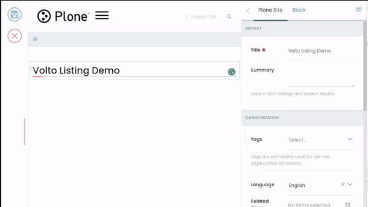

# volto-listing-block

[](https://github.com/eea/volto-listing-block/releases)

[](https://ci.eionet.europa.eu/view/Github/job/volto-addons/job/volto-listing-block/job/master/display/redirect)
[](https://sonarqube.eea.europa.eu/dashboard?id=volto-listing-block)
[](https://sonarqube.eea.europa.eu/dashboard?id=volto-listing-block)
[](https://sonarqube.eea.europa.eu/dashboard?id=volto-listing-block)
[](https://sonarqube.eea.europa.eu/dashboard?id=volto-listing-block)

[](https://ci.eionet.europa.eu/view/Github/job/volto-addons/job/volto-listing-block/job/develop/display/redirect)
[](https://sonarqube.eea.europa.eu/dashboard?id=volto-listing-block&branch=develop)
[](https://sonarqube.eea.europa.eu/dashboard?id=volto-listing-block&branch=develop)
[](https://sonarqube.eea.europa.eu/dashboard?id=volto-listing-block&branch=develop)
[](https://sonarqube.eea.europa.eu/dashboard?id=volto-listing-block&branch=develop)

[Volto](https://github.com/plone/volto) add-on

## Features

This package aims to provide a framework for more flexible listings for the
Listing Volto block. It introduces the concept of UniversalCard, which is a
generic component governed by a designated "itemModel".

It provides several views and integrates with the Teaser Grid.



## Upgrade

### Upgrading to 11.x

The card templates and the listing layouts are consolidated. Existing content
keeps rendering as before and is migrated to the new model when a block is
edited, so no upgrade step is needed.

**Card templates.** There are only two card templates left, the others are
now controls of these:

| Old template (`itemModel['@type']`) | New template | Settings                                          |
| ----------------------------------- | ------------ | ------------------------------------------------- |
| `card`                              | Card         | image on top                                      |
| `imageOnLeft` / `imageOnRight`      | Card         | image on the left / right                         |
| `imageCard`                         | Card         | content over the image                            |
| `imageOnBottom`                     | Card         | title on top, logo below it                       |
| `visualizationCard`                 | Card         | visualization element order, benchmark level      |
| `item`                              | List item    | image on the left / right / none                  |
| `searchItem`                        | List item    | head meta (content type and date above the title) |
| `simpleItem`                        | List item    | compact size, no image and no description         |

**Layouts.** The listing block offers List (`summary`, now the default),
Grid (`cardsGallery`), Carousel (`cardsCarousel`) and Accordion. The layout
picks the template: List uses the list item, Grid and Carousel use the card.

- Visualization Cards (`cardsVisualization`) becomes a Grid with five columns
  and the top accent card style.
- Volto's own listing templates and the Image Gallery are only offered for the
  blocks that already use them.
- Blocks saved with a variation that is not registered anymore keep Volto's
  default list, as do search blocks without a results layout.

**Editing.** The listing, search and teaser blocks migrate their data when
they are selected in edit mode. Save the page to store the migrated data. The
view migrates on the fly, so unedited pages render the same.

**Customizations.** These modules were removed, so update the shadows or
imports that point to them:

- `blocks/Listing/item-templates/CardTemplates.jsx`, `ItemTemplates.jsx`,
  `SearchItemTemplate.jsx`, `SimpleItemTemplates.jsx` and
  `VisualizationCard.jsx`, replaced by `CardTemplate.jsx` and
  `ItemTemplate.jsx`
- `blocks/Listing/layout-templates/VisualizationCards.jsx`, replaced by
  `Gallery.jsx`

Card templates registered by other add-ons in
`config.blocks.blocksConfig.listing.extensions.cardTemplates` are not migrated
and keep rendering themselves. The migration lives in
`src/components/UniversalCard/migrate.js`.

### Upgrading to 1.x

This version requires: `@plone/volto >= 16.0.0.alpha.15` (`volto-slate` part of Volto Core).

## Getting started

### Try volto-listing-block with Docker

      git clone https://github.com/eea/volto-listing-block.git
      cd volto-listing-block
      make
      make start

Go to http://localhost:3000

`make start` now defaults to Volto 18. To run the same setup against Volto 17, use:

      VOLTO_VERSION=17 make
      VOLTO_VERSION=17 make start

### Add volto-listing-block to your Volto project

1. Make sure you have a [Plone backend](https://plone.org/download) up-and-running at http://localhost:8080/Plone

   ```Bash
   docker compose up backend
   ```

1. Start Volto frontend

* If you already have a volto project, just update `package.json`:

   ```JSON
   "dependencies": {
       "@eeacms/volto-listing-block": "*"
   }
   ```

   and `volto.config.js`:

   ```JavaScript
   const addons = ['@eeacms/volto-listing-block'];
   ```

* If not, create one with Cookieplone, as recommended by the official Plone documentation for Volto 18+:

   ```
   uvx cookieplone project
   cd project-title
   ```

1. Install or update dependencies, then start the project:

   ```
   make install
   ```

   For a Cookieplone project, start the backend and frontend in separate terminals:

   ```
   make backend-start
   make frontend-start
   ```

   For a legacy Volto 17 project, install the package with `yarn` and restart the frontend as usual.

1. Go to http://localhost:3000

1. Happy editing!

## Release

See [RELEASE.md](https://github.com/eea/volto-listing-block/blob/master/RELEASE.md).

## How to contribute

See [DEVELOP.md](https://github.com/eea/volto-listing-block/blob/master/DEVELOP.md).

## Secret Scanning

This repository uses the Betterleaks GitHub Action to scan the current
repository content on every push and pull request. The scan uses the rules in
`.gitleaks.toml` and uploads a `betterleaks-report` artifact when a finding is
detected.

If the optional SMTP secrets are configured, failed scans also send an email to
the last commit committer. The workflow expects these repository or
organization secrets:

- `SMTP_URL`
- `SMTP_PORT` (optional, defaults to `25`)
- `SMTP_EMAIL`
- `SMTP_PASSWORD` (optional if the SMTP server does not require authentication)

Port `465` is sent with direct TLS; other ports use the default SMTP handshake.
The email includes a short finding summary from the redacted Betterleaks report,
including the redacted matched line from each finding.

There are three common outcomes:

1. **Everything is OK.** The `Betterleaks / Scan for secrets` check is green and
   no action is needed. Regular references to runtime values are OK, for example:

   ```js
   const tokenFromCookie = req.universalCookies.get('auth_token');
   ```

2. **A real secret was found.** The check is red and the workflow log asks you to
   download the `betterleaks-report` artifact. Open the artifact from the GitHub
   Actions run and check the reported file, line and rule. Remove the committed
   value, move it to the proper secret store, and rotate it if it was exposed.
   A report entry looks like this:

   ```json
   {
     "RuleID": "secret-literal-assignment",
     "File": "src/config.js",
     "StartLine": 12,
     "Secret": "[REDACTED]"
   }
   ```

3. **The finding is a false positive.** Keep the value only if it is clearly not
   sensitive, such as a test fixture, placeholder, or public example. Add
   `betterleaks:allow` on the same line and include a short explanation in the
   pull request.

   ```js
   const testPassword = 'admin'; //betterleaks:allow
   ```

   ```yaml
   password: "admin" #betterleaks:allow
   ```

Do not add `betterleaks:allow` to real credentials.

## Copyright and license

The Initial Owner of the Original Code is European Environment Agency (EEA).
All Rights Reserved.

See [LICENSE.md](https://github.com/eea/volto-listing-block/blob/master/LICENSE.md) for details.

## Funding

[European Environment Agency (EU)](http://eea.europa.eu)
