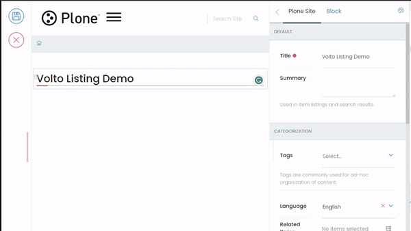

# @eeacms/volto-listing-block

[](https://github.com/eea/volto-listing-block/releases)
[](https://ci.eionet.europa.eu/view/Github/job/volto-addons/job/volto-listing-block/job/master/display/redirect)
[](https://sonarqube.eea.europa.eu/dashboard?id=volto-listing-block)

[Volto](https://github.com/plone/volto) add-on

## Features

This package aims to provide a framework for more flexible listings for the
Listing Volto block. It introduces the concept of UniversalCard, which is a
generic component governed by a designated "itemModel".

It provides several views and integrates with the Teaser Grid.



## Upgrade

### Upgrading to 11.x

Version 11 replaces the many card templates and listing variations with two
card templates and a set of controls. Existing content is migrated on the
fly, so there is no upgrade step to run in Plone.

#### What changed

**Layouts.** The listing block offers four layouts: List (`summary`, now the
default), Grid (`cardsGallery`), Carousel (`cardsCarousel`) and Accordion. The
layout picks the card template: List uses the list item, Grid and Carousel use
the card.

**Card templates.** Only Card and List item are left. Every former template is
now a combination of their controls:

| Former template (`itemModel['@type']`) | Now       | Controls                                      |
| -------------------------------------- | --------- | --------------------------------------------- |
| `card`                                 | Card      | image on top                                  |
| `imageOnLeft` / `imageOnRight`         | Card      | image on the left / right                     |
| `imageCard`                            | Card      | content mode: image only (title on image)     |
| `imageOnBottom`                        | Card      | content mode: title and logo                  |
| `visualizationCard`                    | Card      | visualization elements order, benchmark level |
| `item`                                 | List item | image on the left / right / none              |
| `searchItem`                           | List item | content type and date above the title         |
| `simpleItem`                           | List item | size: compact (title only)                    |

The Visualization Cards layout (`cardsVisualization`) becomes a Grid with five
columns and the "Top accent border" card style.

**Card controls.**

- **Card elements** (List item elements for the list): one control that lays
  out the metadata of the card. Drag the elements (image, content type, date,
  title, benchmark level, description, tags, call to action) to reorder them,
  switch them on or off, and expand them for their settings, e.g. the event
  date, the title and description max lines, the icon or the call to action
  label and URL.
- **Content mode** (card): image and content, image only (title on image) or
  title and logo (teasers).
- **Image position**: top, left, right or none. Grid and Carousel cards only
  offer top.
- **Flip card**: the card turns over on hover or keyboard focus. Each element
  chooses its side in the card elements.
- **Size** (list item): default or compact (title only).
- **Border** (styling): no border, top accent border (cards) or bordered.

#### How the content is migrated

The migration is a JavaScript function
(`src/components/UniversalCard/migrate.js` for the card model,
`src/blocks/Listing/variations.js` for the listing and search layouts), not a
Plone upgrade step:

- **View:** the blocks are migrated in memory on every render, the stored data
  is not changed. Pages render the same as before the upgrade.
- **Edit:** when a listing, search or teaser block is selected, its data is
  rewritten to the new model and the controls show the migrated values.
- **Save:** saving the page stores the migrated data. Pages that are never
  edited keep the old data and keep being migrated on the fly.

Data that is already migrated is left unchanged. Volto's own listing templates
and the Image Gallery stay available only for the blocks that already use
them. Blocks saved with a variation that is not registered anymore keep
Volto's default list, as do search blocks without a results layout.

#### How to upgrade

1. Update the add-on in your project's `package.json` and run `yarn`:

   ```JSON
   "dependencies": {
       "@eeacms/volto-listing-block": "^11.0.0"
   }
   ```

2. Update the customizations (shadows) and imports of the removed modules:
   - `blocks/Listing/item-templates/CardTemplates.jsx`, `ItemTemplates.jsx`,
     `SearchItemTemplate.jsx`, `SimpleItemTemplates.jsx` and
     `VisualizationCard.jsx`, replaced by `CardTemplate.jsx` and
     `ItemTemplate.jsx`
   - `blocks/Listing/layout-templates/VisualizationCards.jsx`, replaced by
     `Gallery.jsx`

3. Card templates registered by other add-ons in
   `config.blocks.blocksConfig.listing.extensions.cardTemplates` are not
   migrated and keep rendering themselves. Check that they still look right
   with the new layouts.

4. Check a few pages with listings, search results and teasers: open them in
   edit mode, select the blocks, check the card controls and save.

### Upgrading to 1.x

This version requires: `@plone/volto >= 16.0.0.alpha.15` (`volto-slate` part of Volto Core).

## Requirements

### Backend

- [Plone](https://plone.org/download)
- [plone.restapi](https://pypi.org/project/plone.restapi/)

### Frontend

- Node.js: `>=22.0.0`

## Installation

1. Make sure you have a [Plone backend](https://plone.org/download) up-and-running at http://localhost:8080/Plone

   ```Bash
   docker compose up backend
   ```

1. Start Volto frontend

* If you already have a volto project, just update `package.json`:

   ```JSON
   "dependencies": {
       "@eeacms/volto-listing-block": "*"
   }
   ```

   and `volto.config.js`:

   ```JavaScript
   const addons = ['@eeacms/volto-listing-block'];
   ```

* If not, create one with Cookieplone, as recommended by the official Plone documentation for Volto 18+:

   ```
   uvx cookieplone project
   cd project-title
   ```

1. Install or update dependencies, then start the project:

   ```
   make install
   ```

   For a Cookieplone project, start the backend and frontend in separate terminals:

   ```
   make backend-start
   make frontend-start
   ```

1. Go to http://localhost:3000

1. Happy editing!

## License

See [LICENSE.md](LICENSE.md) for details.

## Funding

[European Environment Agency (EU)](http://eea.europa.eu)
